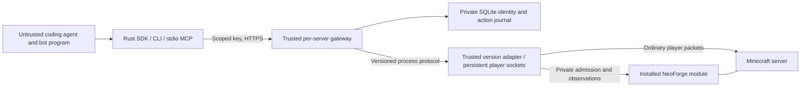

# Boundaries and compatibility

`minecraft-sdk-core` defines version-independent operations and errors.
`minecraft-sdk` has no Java/modpack dependencies. `minecraft-sdk-gateway` owns
identity resolution, key hashing, session fencing, durable idempotency and HTTP.
`minecraft-sdk-java-1-21-1` owns wire encoding and native state conversion.
The Java module implements only local admission and own-player observations;
normal player handlers perform mutations. Mod behavior remains server-owned.

Registration labels cannot select player names or UUIDs. The gateway generates
UUIDs and `.S_` names, which cannot be authenticated as ordinary Java usernames.
The native registry is instance-owned and persistent; registered identities are
separate from connected player capacity. Existing identities can be reserved.
Keys contain 256 bits of OS randomness; only domain-separated SHA-256 hashes
bound to server instance and bot ID are kept in the gateway database.

A native ticket expires after ten seconds, binds the exact registered UUID,
name and local TCP source port, and is consumed once. It never changes global
Java authentication. Operators must keep the native directory/token private.

The gateway serializes each character's lifecycle/mutations. Its adapter transport
drains replies even when an HTTP caller disappears, preventing replies crossing
character boundaries. The journal commits intent before dispatch, keeps action
IDs permanently, fences multiple gateway processes with a file lock, and
quarantines failed adapter communication. Active sessions pin adapter versions.

No HTTP or MCP operator endpoint exists. Operator recovery/revocation uses a
mode-600 Unix socket beside the gateway journal, with same-UID peer checks.
Revocation disables authentication before attempting the native disconnect.
Recovery requires a confirmed disconnected controller and does not start it.

Limits on registration rate, resource use, observation bounds, and normal server
capacity are deployment constraints, not a fixed SDK bot registry ceiling.
Adapters can reject unsupported versions/actions explicitly. A namespace in a
remote manifest never grants permission to load or execute code.

Operator-installed Java modules can register namespaced read-only providers with
`SdkService.registerObservationProvider`. The callback receives the actual admitted
non-operator Survival player and a bounded JSON object. Providers must validate
their exact input fields and retain own-player visibility/permission rules. They
must not accept an actor override, filesystem path or executable code. Registration
happens on the server thread after SDK startup; discovery advertises installed
providers. Untrusted requests cannot register or load a provider.

`POST /v1/bots/{bot}/observations/query` accepts `{capability,input}` under the same
key/controller binding as normal observations. Rust `Client::read_observation`,
`mc-sdk query PROFILE QUERY.json`, and MCP `minecraft_observation_query` expose it.
Input is at most 8 KiB and an object; responses are at most 8 MiB. Default observations
retain their 1 MiB client bound. Missing providers return `unsupported_capability`.

`motion_frame` is an optional typed action for programs simulating individual
walking frames. The Java adapter checks swept collision, ordinary per-frame
distance, gravity and continuous airborne velocity, and derives ground contact.
A caller cannot supply its own ground flag. Unsupported airborne states fail
closed. `move` remains the higher-level supported-waypoint operation.
