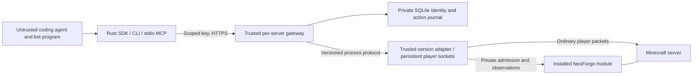

# Boundaries and compatibility

`minecraft-sdk-core` defines version-independent operations and errors.
`minecraft-sdk` has no Java/modpack dependencies. `minecraft-sdk-gateway` owns
identity resolution, key hashing, session fencing, durable idempotency and HTTP.
`minecraft-sdk-java-1-21-1` owns wire encoding and native state conversion.
The Java module implements only local admission and own-player observations;
normal player handlers perform mutations. Mod behavior remains server-owned.

Registration labels cannot select player names or UUIDs. The gateway generates
UUIDs and stable readable `.S_` names such as `.S_MayaWoods`, which cannot be
authenticated as ordinary Java usernames. Name collisions receive another
available first/last-name combination, with a numeric suffix only after the
unsuffixed combinations are occupied. Registration labels do not select names.
On gateway startup, old hash-generated names are upgraded transactionally;
UUIDs, credentials, labels and action history remain intact. Install the matching
native module before the upgraded gateway: native registration permits only a
one-time hash-to-readable rename for the same disconnected UUID with no pending
admission ticket. Imported `.AI_` characters and existing readable names retain
their names. Saved inventories and progress continue to belong to the same UUID.
The native registry is instance-owned and persistent; registered identities are
separate from connected player capacity. Existing identities can be reserved.
Keys contain 256 bits of OS randomness; only domain-separated SHA-256 hashes
bound to server instance and bot ID are kept in the gateway database.

A native ticket expires after ten seconds, binds the exact registered UUID,
name and local TCP source port, and is consumed once. It never changes global
Java authentication. Operators must keep the native directory/token private.

The gateway orders each character's reads, lifecycle and mutations in its own
lane. Each connected character has a separate operator-configured adapter process
and player socket. A long action or failed transport for one character does not
hold another character's transport lock. A bounded deployment queue limits
in-flight work; normal server admission determines connected player capacity.
An empty adapter process serves initial discovery without owning a character.

Since Rust alpha.4, the gateway and Rust adapter must both support process protocol
2. The initial bare `Discover` advertises `limits.process_protocol`; subsequent
JSON-line frames carry an OS-random channel ID, increasing request ID and actor
binding. Replies must match the channel, request, instance, bot, UUID, operation
and applicable action ID. Transport errors or mismatches close only that lane
and invalidate its controller. Reconnection does not replay an interrupted action.
Replies drain even when an HTTP caller disappears, retaining their queue permit
and lifecycle ordering until completion. Active sessions pin the adapter version;
new sessions reject a changed binary until the gateway is deliberately restarted.

HTTP API 1 and the private NeoForge native API 1 are unchanged. This Rust transport
change does not require replacing the alpha.3 NeoForge module. Deploy the matching
Rust gateway and adapter together; restarting the gateway disconnects SDK players
but does not restart the Minecraft server. Independent process lanes alone do
not establish Survival competence; finite controls and client behavior are
separate layers described below.

The journal commits intent before dispatch, keeps action IDs permanently and
fences multiple gateway processes with a file lock.
An exact repeated action request returns its existing receipt with response-only
`evidence.gateway_delivery.action_id_already_recorded = true` and
`new_intention_dispatched = false`. Original outcomes, native effects and stored
journal evidence stay historical and unchanged. Running-status refresh can still
observe an existing action; this metadata only says no new intention was
dispatched for the repeated request. SDK waits retain it through status reads.
Use current postconditions to assess a resumed program, and inspect/reconcile
uncertain IDs before distinct new work. A cached verified effect is not a new
effect attributed to the latest program run.

No HTTP or MCP operator endpoint exists. Operator recovery/revocation uses a
mode-600 Unix socket beside the gateway journal, with same-UID peer checks.
Revocation disables authentication before attempting the native disconnect.
Recovery requires a confirmed disconnected controller and does not start it.

Limits on registration rate, resource use, observation bounds, and normal server
capacity are deployment constraints, not a fixed SDK bot registry ceiling.
Adapters can reject unsupported versions/actions explicitly. A namespace in a
remote manifest never grants permission to load or execute code.

Operator-installed Java modules can register namespaced read-only providers with
`SdkService.registerObservationProvider`. The callback receives the actual admitted
non-operator Survival player and a bounded JSON object. Providers must validate
their exact input fields and retain own-player visibility/permission rules. They
must not accept an actor override, filesystem path or executable code. Registration
happens on the server thread after SDK startup; discovery advertises installed
providers. Untrusted requests cannot register or load a provider.

`POST /v1/bots/{bot}/observations/query` accepts `{capability,input}` under the same
key/controller binding as normal observations. Rust `Client::read_observation`,
`mc-sdk query PROFILE QUERY.json`, and MCP `minecraft_observation_query` expose it.
Input is at most 8 KiB and an object; responses are at most 8 MiB. Default observations
retain their 1 MiB client bound. Missing providers return `unsupported_capability`.

The alpha.10 Java adapter uses one continuous physical writer for each admitted
player connection. It requires matching NeoForge physics and action-effect facts. Idle gravity,
collisions and momentum continue outside coding-agent containers and independently
of model requests or gameplay actions. Native observations supply dimensions,
effective jump strength, gravity, surface friction and effects. Server relocation
invalidates old trajectories; native velocity/explosion packets preserve external
momentum without automatically releasing a held finite movement input. Target
verification, expiry, explicit cancellation and relocation/death fences still
apply. Movement receipts retain bounded coalesced `server_momentum` diagnostics;
these do not attribute damage or certify target completion. Unsupported flight
physics fails explicitly. Legacy blocking `move`,
`motion_frame` and `jump`, and `allow_blocking_locomotion=true`, are unsupported
with this controller. Use `start_move`, including its jump option.

The waypoint preview integrates the same acceleration, braking, jumping,
friction, gravity and collision equations as the continuous physical writer,
starting from reported position and momentum in the observed scene. It can
assess feasible airborne steering. An unreachable constant-speed jump arc no
longer admits a movement that the held-input controller cannot execute. Preview
remains a prediction: later world changes, momentum updates or cancellation can
change its outcome. The changed scene key invalidates old failed route edges
without removing their history.

Rust alpha.5 additionally advertises `minecraft:finite_locomotion`. `start_move`
accepts a waypoint, `jump` and positive `max_ticks` (fifty milliseconds per tick).
The input lease begins with its first submitted physical frame, so a one-tick
request cannot expire in the writer's scheduling queue before applying input.
Discovery advertises the deployment's `finite_control_max_ticks`; the Rust
adapter configuration defaults to 100 and permits an operator budget of 1–600.
It returns `running` immediately and leases finite input to the connection's
physical controller, which sends ordinary player packets. Own observations and non-conflicting
actions remain available. `cancel_control` references that same character's
durable action ID and has its own durable request ID. Inspect both IDs through
normal action status. Cancellation releases input; gravity and momentum continue.
An `observed` arrival must place the native feet pose strictly within 0.15 blocks
of the requested target. The adapter and navigator share this arrival contract.
The controller brakes before releasing input; post-release drift cannot silently
widen the tolerance. Receipts retain the target and tolerance for inspection.
Navigation retains a terminal, verified pose outside that target as
`target_not_reached`, preserving the native outcome and retiring the intention
without replay. Missing native proof or mismatched actor bindings stay fenced.

Rust adapter alpha.13 additionally advertises `minecraft:waypoint_passthrough`.
Rust adapter alpha.14 rejects mining starts on currently observed Java air cells
before dispatch. Its start verifier also requires a non-air target and a newly
observed mining transition or block change. A native active flag on air cannot
establish block mining. Finish/cancel retain their existing interruption and
release semantics. Core registry identifiers remain deployment independent.
From alpha.15, the Rust adapter and NeoForge module must both support
`minecraft:life_identity`. Observations bind the native player object through
`player.life_id` and the sample-clock epoch, including when ordinary respawn
reuses the numeric entity ID. See [respawn recovery](respawn-recovery.md) for
the matching installation pair and native verification gate.

`start_move_through` takes `target` and positive `max_ticks`. It holds ordinary
movement input until crossing the waypoint plane within a 0.35-block lateral
corridor and 0.05-block vertical tolerance, then releases input. Fresh native
pose and release evidence are required. This is a passage receipt, not a stopped
arrival: passive momentum continues. The adapter accepts only distinct, supported,
level, dry-ground paths with known collision geometry. Jumps, airborne starts,
fluids and unknown support require another control. Cancellation and expiry
release input without claiming passage. Existing `start_move` semantics remain
unchanged; use it for precise interaction positions.

The default body opts into passage only when advertised, escaping exclusively
ranged visible threats on a route with a fully observed safe metre beyond its
waypoint. Mixed threats, fire, jumps and precision work retain stopped controls.
This reduces avoidable braking; native matched-pressure evaluations must still
establish whether the character survives.

Interactions use a separate finite observer lane. Mining, placement, menu changes,
item use and combat can return `running` while their native effects develop. An
initial lack of change is progress information, not an uncertain mutation. Inspect
the current interaction before replacing it; its final receipt must reach the
gateway journal before a later interaction takes its slot. Movement, looking,
conversation and observation remain available. The container brain flushes terminal
interaction receipts and can cancel held item use before urgent movement.

`place.block` identifies the clicked cell and `face` its protocol face, not a
destination coordinate. The adjacent candidate is down/up/north/south/west/east
for faces 0/1/2/3/4/5. Item-specific replacement and merging remain server rules.
Failed-placement feedback retains bounded initial/final receipt samples for both
cells, including runtime block state, replaceability and permission observations.
These historical samples survive general history compaction; absent cells stay
unknown. They neither certify current legality nor authorize uncertain replay.

`start_use_item` accepts `hand` and positive `max_ticks`, bounded by the deployment's
finite-control limit. Native game ticks measure active held use; a wall deadline
of twice that tick budget plus two seconds bounds stalled execution. Legacy
`use_item` uses the deployment budget. `cancel_use_item` references the original
action ID and releases ordinary held input. A cancelled or expired use can have
verified release without a verified consumption effect. Food/health gains remain
separate observations. A bow or mod item without an implemented completion verifier
can expire without a success claim even when the input was released correctly.

The server records bounded, connection-scoped post-effect sequences for finished
item use and direct player-attack damage. Attack verification binds the new event
to this actor, native dimension and the originally observed entity UUID; another
attacker lowering the target's health is insufficient. Menu verification covers a
new own-player menu after exclusive interaction, not arbitrary mod side effects.
Ordinary permission/claim handling still runs in Minecraft's packet handlers;
observation hooks grant no additional authority. A finite effect budget expiring
does not assert that a later effect is impossible. Actual connection, dimension,
clock or observation interruption remains uncertain and requires reconciliation.
Reconciliation retains its explicit lack of historical proof and never resends
the original input.

Rust clients can call `perform(&request, wait_duration)` to dispatch exactly once
and wait using status reads only. `wait_for_action(id, wait_duration)` resumes a
wait. The caller's deadline returns the latest receipt, possibly still running;
it does not cancel the action. The CLI equivalent is
`mc-sdk perform PROFILE ACTION.json [WAIT_MS]` (default wait 10,000 ms).
The release is checked against fresh native poses without requiring a guaranteed
safe landing. A legal action may cause ordinary fall damage or death.

`observed` means the requested target was observed, `cancelled`/`expired` mean
the corresponding finite control ended, and `failed` means execution ended
without the goal effect. Evidence separately states whether its native effect
was verified. Missing an immediate effect is not interruption. Genuine transport
or verification loss remains uncertain and requires explicit reconciliation,
which never replays or retrospectively certifies a historical effect. A running
control is separate from that uncertainty fence. Gateway restart or controller
disconnection converts uncaptured running results to uncertain records.

Collision geometry is refreshed for this character. The controller waits briefly
for missing geometry and ends the connection if fresh observations cannot be
recovered, preserving uncertain action IDs rather than inventing air. A second
locomotion control waits for cancellation/completion; look and ordinary actions
continue. Deterministic physics and native fixtures remain separate evidence;
support for every fluid, vehicle or mod is not implied. Older clients cannot decode the new outcome variants
for actions created by newer clients. Keep a matching gateway/adapter pair and
preserve the journal through upgrades; never restore an old journal to replay work.

Alpha.6 adds authenticated own-character `GET /v1/bots/{bot}/actions/pending`.
It returns typed pending intentions and receipts, including interrupted imports
without exposing their private journal paths. Independent conversation, looking,
movement, combat and respawn can continue while an unrelated inventory/world
mutation remains uncertain. Its durable ID remains fenced until reconciliation;
this permission never retries the interrupted mutation.

The NeoForge alpha.4 module advertises `minecraft:survival_facts` and
`minecraft:delivered_chat`. Public observations include visible hostile entities,
moving projectiles, collision geometry, food/use state and ordinary player
attributes. Chat is collected per recipient after the server queues that
connection's player, disguised/private, system or action-bar packet. Filtering
is retained; signatures are not claimed verified. Buffers have connection epochs,
sequence numbers, dropped counts and bounded marked text. No other recipient's
private chat is queried. The Rust player socket still handles signed-chat
acknowledgements. Installing these Java hooks requires a saved server restart.

The optional reference brain runs its responsive body in a separate Rust thread
and runtime, with a separate journal. It evades observed threats, can preempt a
finite program control, resumes queued work when safe, and performs ordinary
respawn. This initial policy is experimental: eating, combat effectiveness,
fluids, complex navigation and general Survival strength require further native
evidence. Health, shelter and threats do not gate model reasoning or conversation.

AI-edited behavior programs are Lua 5.4 modules embedded through mlua in that
Rust Brain. A pure `step(context)` returns saved JSON state and one typed SDK
operation. Rust retains execution, receipts, recovery and body arbitration.
Changed source is validated before activation at a settled action boundary;
invalid candidates retain the last good module. Lua state is durable and scoped
to character, instance, workspace path and task revision. The Brain, body and
native session stay resident across these updates. Pending actions prevent
activation, and interrupted host commands remain fenced against replay.

Bounded diagnosis includes the latest failed direct SDK intention and its outcome
or error code, independently of an older generated-program experiment. Selecting
a different held inventory slot changes relevant gameplay facts. Fresh receipt
IDs, error wording, aiming jitter and subcell waypoint jitter do not replenish a
failure's allowance; cancellation target IDs retain their semantic identity.
Persisted failure context is historical client feedback, never effect proof or
permission to replay an uncertain mutation. Unchanged exhausted diagnoses remain
bounded across restart, and provider allowances remain unchanged.

After consuming a diagnosis, the controller offers one persistent normal
inspection window for useful alternatives rather than immediately suspending
all task reasoning. It does not replenish the exhausted investigation. The
exact observed empty-hand placement request is locally fenced only when its recorded relevant
facts, native actor life/clock and goal still match. Changed hit parameters can
matter for slabs or mod controls; cost-scope jitter normalization is not used to
equate distinct requests here. Another inspection-only loop reaches the existing
ceiling, and restarting does not renew it. Combat and item cooldowns retain their
normal retry semantics. Chat, uncertain-action reconciliation,
provider quotas and ordinary native permissions retain their existing paths.
This client cost guard is not a trusted security or gameplay-authority boundary.

For an explicit operator-owned conformance character, `handoff-probe-worker`
injects seven bounded fixture choices in a fresh workspace: select an empty
hotbar slot, click an observed nearby noninteractive vanilla block with that empty hand, spend four
investigation decisions on unchanged observations, and request the exact failed
click once more to test the local fence. It then delegates to the ordinary
allocated model worker to perform the requested task. It never supplies a task
solution, discards items or installs a world fixture. Missing terrain, a changed
task/actor or a nonempty hand rejects the fixture. Count injected choices
separately from actual model admissions and autonomous progress. This diagnostic
is not a production strategy; preserve both stalled and repaired runs.

The body can attempt cooldown-ready defense against a visible hostile within
three blocks while its finite escape continues. It does not pursue targets or
interrupt a running item interaction to attack. Native player permissions,
reach, sight and damage verification still apply. Owned escape routes with less
than 0.2 blocks of displacement over 14 advancing game ticks are cancelled and
excluded from the next local route selection. Observation lag, a new entity life,
dimension or native clock epoch resets this progress window. These mechanics
require hazard-scene evidence; passing transport tests is not a Survival claim.
An active body dodge retains the incoming projectile identities it responded to.
Repeated samples of those projectiles do not by themselves cancel that dodge;
a new incoming identity, movement toward a nearby threat or native evidence of a
stuck route can trigger replanning. Diagnostic samples retain these identities
and the cancellation reason so motion and reaction can be checked separately.

If defensive movement makes less than two blocks of displacement over 80
advancing native ticks, the body can request small `minecraft:movement_options`
pages in a background task. This covers short oscillations that individually
complete their controls. Each read has a 750 ms deadline; observation and urgent
defense continue independently. Close threats, incoming projectiles, active
fuses, fire and water emergencies retain the fast policy. A quiet stalled body
can briefly hold its completed input while a prediction arrives.

After a definite native trajectory refusal, movement instead requires fresh
native options for that escape episode; hazards do not authorize another blind
geometric guess. A ready page with zero usable options may follow its advancing
cursor while incomplete, up to four ready pages of eight requested candidates
per physical search. Ready-page continuations retain 500 ms spacing and the
750 ms deadline. One busy-readiness retry instead honors the existing clamped
25–5000 ms server hint. Continuations require the exact first origin, scene and
pinned target; they stop at the first usable options, complete result, malformed
or stale page, or exhausted budget. The existing single changed-threat hint
refresh cannot refund these read budgets. Observations and independent defense
continue, but an empty bounded search does not establish a safe escape or
guarantee protection while another read is pending.
Each existing query-result event includes bounded response-readiness metadata,
raw versus usable option counts, pinned request binding, transport elapsed time,
remaining policy state and its final stop/continue reason. Unknown or malformed
ignored fields stay unknown in diagnostics rather than changing validation.
Reported `busy=true` aggregates correction or running-control gates; it cannot
identify which gate held the query. No raw response or terrain is added.

Predictions are fenced by actor life, dimension, native clock, pose and terrain.
One already-selected cover path may finish a remaining finite leg when first
occlusion interrupts it and its owned preceding control is natively `Observed`,
released, and at the expected endpoint. The original actor/life/clock and
control ID remain bound; fresh known terrain, current threat guards and ordinary
native movement admission still apply. Visibility changes during the original
running or releasing input do not start the occlusion lease. Only an advancing
terminal sample at its endpoint can do so; visible completion replans normally.
Urgency, uncertain/cancelled input, foreign control, missing perceived facts or
reacquisition after terminal occlusion invalidate the continuation. A new escape
also waits while its exact owned control explicitly reports unreleased input;
independent observation, urgent cancellation and reasoning continue. Optional
operator diagnostics record bounded handoff phase changes and current hazards.
The one continuation is consumed before dispatch, stops at its old waypoint,
and cannot seed another hidden plan. It grants no hidden-cover reward, Hold,
new goal or claim of protection. Multi-shooter plans, displaced endpoints and
unknown remaining terrain have no continuation. Offline scene replay establishes
the policy change only; Survival effectiveness requires a new native case.

Changed scenes restart pagination; malformed, stale, hazardous or out-of-range
candidates cannot become controls. The body ranks admissible candidates using
its current threat/cover policy. A native prediction can supply a low-clearance
step that the fast geometric arc rejects, but still requires ordinary fresh
action admission and observed completion. There is one gameplay controller;
this fallback grants no competing model control or extra model allowance.
`body-probe` exercises blocked-reasoning and actual-compilation diagnostics;
`body-probe inspect-observation` replays only the fast policy without acting.
`body-probe CONFIG exposed SECONDS` deliberately disables protection and samples
native health on a bounded timer to check actual hostile pressure. Exposed
controls never count as agent successes. Record weak exposures and timing errors;
the presence of a hostile alone does not demonstrate a Survival challenge.
These diagnostics do not establish general Survival competence. For comparable
enemy starts, use the optional [observed stimulus admission](native-body-diagnostics.md)
barrier; an after-startup scene alone cannot prove the intended initial pressure.

Visible hostile phantoms receive a 32-block warning radius in the replaceable
body policy rather than the ordinary 10-block melee radius. The body prefers
approaching observed low collision roofs over increasing open-ground distance.
Refuge candidates require known clear, supported floor and solid cover over the
player footprint; unseen shelter and foliage without collision do not qualify.
Observed extra horizontal roof coverage adds an interior preference, capped at
one block and computed from continuous collision cover. A covered corner and
roof interior are not equally protective. This remains a client heuristic:
flyers may enter from the side, and a roof does not establish invulnerability.
A visible flyer within 4.5 blocks disables the refuge bonus so it cannot pin the
body in place during contact-range intrusion. Ordinary supported retreat and
cooldown-ready defense remain available.
This preference is disabled for incoming projectiles, primed blasts and burning,
and cannot reward a landing within 4.5 blocks of another visible melee threat.
A roof is a route preference, not an immunity or survival guarantee. Normal
collision admission, observed outcomes, defense and recovery still apply.
Native flying-attack trials with blocked inference and real compilation remain
required; policy regressions alone do not establish effectiveness.

Generated SDK programs inherit `MC_SDK_ARBITER`, a private same-UID Unix socket.
It accepts bounded typed actions and no credentials/actor override. Urgent body
control defers ordinary program actions; conversation remains available. Stalled,
disappearing and partial callers cannot own a persistent action lease. This is
cooperative client scheduling, not a security boundary against code holding its
own bot key: the trusted gateway and ordinary server permissions remain that
boundary. The engine fails closed on stale body observations and disconnects on
controlled exit. A whole-container crash still needs deployment supervision.

An independent event-driven Luna conversation loop records normally delivered
chat and may send a reply or supply a parameterized gameplay goal while Sol
develops code. Provider credentials and provider-side tools remain absent from
the workspace. Deployments must allocate independent bounded model lanes while
retaining their global inference and daily budgets. `await_chat_goal` supports a
player-driven pilot without idle inference polling. Model errors are retained;
unchanged rejected requests are not automatically resubmitted.

Model allocation and work purpose are independent. If Sol's daily allocation is
unavailable, a development turn sent to allocated Luna retains `purpose:develop`.
The restricted reference inference service uses medium reasoning for development
and Sol, and low reasoning for routine Luna turns. This grants no tools, host
execution or extra calls. Replies retain numeric provider token counters when
available and the reported effort; missing counters remain unknown. The
`model-probe investigate` mode tests Luna development with saved context without
executing any returned gameplay or workspace tool.

Gate completion requires independently recorded gameplay and merged-source
bindings. These interfaces, diagnostics and a successful compiler build alone do
not establish intelligent gameplay, endurance or competitive performance.
