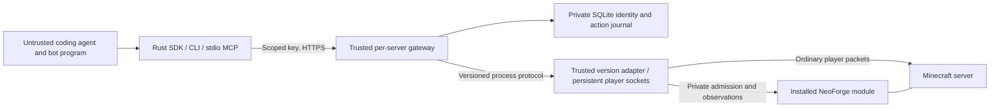

# Boundaries and compatibility

`minecraft-sdk-core` defines version-independent operations and errors.
`minecraft-sdk` has no Java/modpack dependencies. `minecraft-sdk-gateway` owns
identity resolution, key hashing, session fencing, durable idempotency and HTTP.
`minecraft-sdk-java-1-21-1` owns wire encoding and native state conversion.
The Java module implements only local admission and own-player observations;
normal player handlers perform mutations. Mod behavior remains server-owned.

Registration labels cannot select player names or UUIDs. The gateway generates
UUIDs and `.S_` names, which cannot be authenticated as ordinary Java usernames.
The native registry is instance-owned and persistent; registered identities are
separate from connected player capacity. Existing identities can be reserved.
Keys contain 256 bits of OS randomness; only domain-separated SHA-256 hashes
bound to server instance and bot ID are kept in the gateway database.

A native ticket expires after ten seconds, binds the exact registered UUID,
name and local TCP source port, and is consumed once. It never changes global
Java authentication. Operators must keep the native directory/token private.

The gateway orders each character's reads, lifecycle and mutations in its own
lane. Each connected character has a separate operator-configured adapter process
and player socket. A long action or failed transport for one character does not
hold another character's transport lock. A bounded deployment queue limits
in-flight work; normal server admission determines connected player capacity.
An empty adapter process serves initial discovery without owning a character.

Since Rust alpha.4, the gateway and Rust adapter must both support process protocol
2. The initial bare `Discover` advertises `limits.process_protocol`; subsequent
JSON-line frames carry an OS-random channel ID, increasing request ID and actor
binding. Replies must match the channel, request, instance, bot, UUID, operation
and applicable action ID. Transport errors or mismatches close only that lane
and invalidate its controller. Reconnection does not replay an interrupted action.
Replies drain even when an HTTP caller disappears, retaining their queue permit
and lifecycle ordering until completion. Active sessions pin the adapter version;
new sessions reject a changed binary until the gateway is deliberately restarted.

HTTP API 1 and the private NeoForge native API 1 are unchanged. This Rust transport
change does not require replacing the alpha.3 NeoForge module. Deploy the matching
Rust gateway and adapter together; restarting the gateway disconnects SDK players
but does not restart the Minecraft server. Independent process lanes alone do
not establish Survival competence; finite controls and client behavior are
separate layers described below.

The journal commits intent before dispatch, keeps action IDs permanently and
fences multiple gateway processes with a file lock.

No HTTP or MCP operator endpoint exists. Operator recovery/revocation uses a
mode-600 Unix socket beside the gateway journal, with same-UID peer checks.
Revocation disables authentication before attempting the native disconnect.
Recovery requires a confirmed disconnected controller and does not start it.

Limits on registration rate, resource use, observation bounds, and normal server
capacity are deployment constraints, not a fixed SDK bot registry ceiling.
Adapters can reject unsupported versions/actions explicitly. A namespace in a
remote manifest never grants permission to load or execute code.

Operator-installed Java modules can register namespaced read-only providers with
`SdkService.registerObservationProvider`. The callback receives the actual admitted
non-operator Survival player and a bounded JSON object. Providers must validate
their exact input fields and retain own-player visibility/permission rules. They
must not accept an actor override, filesystem path or executable code. Registration
happens on the server thread after SDK startup; discovery advertises installed
providers. Untrusted requests cannot register or load a provider.

`POST /v1/bots/{bot}/observations/query` accepts `{capability,input}` under the same
key/controller binding as normal observations. Rust `Client::read_observation`,
`mc-sdk query PROFILE QUERY.json`, and MCP `minecraft_observation_query` expose it.
Input is at most 8 KiB and an object; responses are at most 8 MiB. Default observations
retain their 1 MiB client bound. Missing providers return `unsupported_capability`.

`motion_frame` is an optional typed action for programs simulating individual
walking frames. The Java adapter checks swept collision, ordinary per-frame
distance, gravity and continuous airborne velocity, and derives ground contact.
A caller cannot supply its own ground flag. Unsupported airborne states fail
closed. `move` is the older blocking waypoint operation. Since alpha.6 the Java
adapter disables blocking `move`, `motion_frame` and `jump` by default. An operator
can enable `allow_blocking_locomotion` for legacy conformance work. Public coding
deployments should leave it disabled and use `start_move`, including its jump
option. A caller cannot hold the observation lane using a legacy walk.

Rust alpha.5 additionally advertises `minecraft:finite_locomotion`. `start_move`
accepts a waypoint, `jump` and positive `max_ticks` (fifty milliseconds per tick).
Discovery advertises the deployment's `finite_control_max_ticks`; the Rust
adapter configuration defaults to 100 and permits an operator budget of 1–600.
It returns `running` immediately, then drives ordinary player position packets
in a separate bounded control thread. Own observations and non-conflicting
actions remain available. `cancel_control` references that same character's
durable action ID and has its own durable request ID. Inspect both IDs through
normal action status; cancellation can remain running while gravity settles.

`observed` means the requested target was observed, `cancelled`/`expired` mean
the corresponding finite control ended, and `failed` means execution ended
without the goal effect. Evidence separately states whether its native effect
was verified. Missing an immediate effect is not interruption. Genuine transport
or verification loss remains uncertain and requires explicit reconciliation,
which never replays or retrospectively certifies a historical effect. A running
control is separate from that uncertainty fence. Gateway restart or controller
disconnection converts uncaptured running results to uncertain records.

The initial finite adapter requires grounded starts, observed collision geometry
and a gravity-only release path for every planned frame. It refuses unsupported
terrain rather than freezing a character in the air. A second locomotion control
must wait for cancellation/completion; look and other ordinary actions can
continue. These conservative client trajectories are not full water, fluid,
vehicle, knockback or modded movement physics conformance. Those need independent
capabilities and native tests. No NeoForge module change is needed for this
optional Rust capability. Older clients cannot decode the new outcome variants
for actions created by newer clients. Keep a matching gateway/adapter pair and
preserve the journal through upgrades; never restore an old journal to replay work.

Alpha.6 adds authenticated own-character `GET /v1/bots/{bot}/actions/pending`.
It returns typed pending intentions and receipts, including interrupted imports
without exposing their private journal paths. Independent conversation, looking,
movement, combat and respawn can continue while an unrelated inventory/world
mutation remains uncertain. Its durable ID remains fenced until reconciliation;
this permission never retries the interrupted mutation.

The NeoForge alpha.4 module advertises `minecraft:survival_facts` and
`minecraft:delivered_chat`. Public observations include visible hostile entities,
moving projectiles, collision geometry, food/use state and ordinary player
attributes. Chat is collected per recipient after the server queues that
connection's player, disguised/private, system or action-bar packet. Filtering
is retained; signatures are not claimed verified. Buffers have connection epochs,
sequence numbers, dropped counts and bounded marked text. No other recipient's
private chat is queried. The Rust player socket still handles signed-chat
acknowledgements. Installing these Java hooks requires a saved server restart.

The optional reference brain runs its responsive body in a separate Rust thread
and runtime, with a separate journal. It evades observed threats, can preempt a
finite program control, resumes queued work when safe, and performs ordinary
respawn. This initial policy is experimental: eating, combat effectiveness,
fluids, complex navigation and general Survival strength require further native
evidence. Health, shelter and threats do not gate model reasoning or conversation.

Generated SDK programs inherit `MC_SDK_ARBITER`, a private same-UID Unix socket.
It accepts bounded typed actions and no credentials/actor override. Urgent body
control defers ordinary program actions; conversation remains available. Stalled,
disappearing and partial callers cannot own a persistent action lease. This is
cooperative client scheduling, not a security boundary against code holding its
own bot key: the trusted gateway and ordinary server permissions remain that
boundary. The engine fails closed on stale body observations and disconnects on
controlled exit. A whole-container crash still needs deployment supervision.

An independent event-driven Luna conversation loop records normally delivered
chat and may send a reply or supply a parameterized gameplay goal while Sol
develops code. Provider credentials and provider-side tools remain absent from
the workspace. Deployments must allocate independent bounded model lanes while
retaining their global inference and daily budgets. `await_chat_goal` supports a
player-driven pilot without idle inference polling. Model errors are retained;
unchanged rejected requests are not automatically resubmitted.

Gate completion requires independently recorded gameplay and merged-source
bindings. These interfaces, diagnostics and a successful compiler build alone do
not establish intelligent gameplay, endurance or competitive performance.
